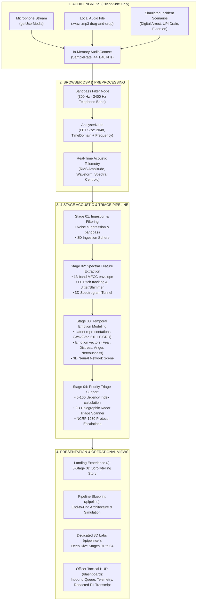

# VOCAL / FORENSICS

> **Real-Time Speech Emotion Analysis for Cybercrime Investigation — Client-Side Prototype**  
> *A high-fidelity, privacy-preserving 3D interactive web application and tactical triage console for emergency cybercrime dispatchers and forensic investigators.*

[](https://nextjs.org/)
[](https://www.typescriptlang.org/)
[](https://threejs.org/)
[](https://tailwindcss.com/)
[](https://developer.mozilla.org/en-US/docs/Web/API/Web_Audio_API)
[](https://nextjs.org/docs/app/building-your-application/deploying/static-exports)
[](LICENSE)

---

## 1. Executive Summary

In high-stress cybercrime incidents—such as **"Digital Arrest" video extortion**, **active unauthorized UPI financial draining**, **senior citizen pension fraud**, and **ransomware coercion**—minutes make the difference between funds lost forever and transactions frozen in time.

**VOCAL / FORENSICS** is a frontend prototype and interactive mission simulator designed to demonstrate how real-time acoustic signal processing and speech emotion recognition (SER) can empower frontline law enforcement officers and helpline dispatchers (e.g., India's **National Cyber Crime Reporting Portal / 1930 Helpline**).

Rather than analyzing words alone (which can be masked or rehearsed), the platform extracts acoustic biomarkers—**pitch instability ($F_0$), micro-tremors (jitter/shimmer), speech pace (WPM), and spectral envelopes (MFCCs)**—to surface indicative stress and distress signals for human triage.

### 🛡️ Core Architecture Pillars

- **100% Client-Side & Privacy-Preserving:** Zero server backend, zero API keys required, zero databases, and zero external audio uploads. All audio decoding and DSP transformations execute purely inside the user's browser memory via the HTML5 Web Audio API.
- **Static Export Ready:** Configured for `output: "export"`. Compiles into a completely standalone static artifact (`out/`) deployable to any static edge CDN or offline air-gapped terminal.
- **Indicative Signal Mandate:** Every emotion reading and urgency score is explicitly badged as assistive telemetry. Human investigators retain full authority—the system assists triage prioritization, never issuing automated verdicts of guilt or truth.

---

## 2. System Architecture & Data Flow



---

## 3. Application Routes & Interactive Laboratories

The application includes 7 dedicated, fully responsive routes equipped with 3D viewports, interactive controls, and tactical telemetry:

| Route | Title | Description & Key Interactive Features |
|---|---|---|
| [`/`](file:///app/page.tsx) | **3D Scrollytelling Experience** | 5-stage pinned-feeling narrative covering Mission, Problem, the 4-Stage Acoustic Pipeline, Interactive Emotion Core (Fear, Anger, Distress, Nervousness) with real-time particle morphing, and Responsible AI & Audio Sandbox. |
| [`/pipeline`](file:///app/pipeline/page.tsx) | **Pipeline Workflow Blueprint** | Comprehensive architectural master plan. Features an **interactive simulation runner** testing multi-profile cybercrime scenarios, step-by-step DSP transformations, mathematical specifications, and automated protocol playbooks. |
| [`/pipeline/audio-ingestion`](file:///app/pipeline/audio-ingestion/page.tsx) | **Stage 01: Ingestion & Filtering** | Browser audio capture (`getUserMedia`), local WAV/MP3 drag-and-drop file decoding, dual real-time oscilloscopes (raw vs. filtered), interactive biquad bandpass filter, and an interactive **3D Ingestion Sphere**. |
| [`/pipeline/feature-extraction`](file:///app/pipeline/feature-extraction/page.tsx) | **Stage 02: Spectral Feature Extraction** | 13-band Mel-Frequency Cepstral Coefficients (MFCC) envelope inspection, fundamental frequency ($F_0$) pitch tracking in Hz, micro-tremor proxies (jitter % and shimmer %), speech tempo (WPM), and an interactive **3D Spectrogram Tunnel**. |
| [`/pipeline/emotion-modeling`](file:///app/pipeline/emotion-modeling/page.tsx) | **Stage 03: Temporal Emotion Modeling** | Reference deep sequence architecture (CNN feature encoder + Wav2Vec 2.0 latent representations + Bidirectional GRU), 4 indicative emotion vectors, attention focus weights, and an interactive **3D Neural Network Node Graph**. |
| [`/pipeline/priority-triage`](file:///app/pipeline/priority-triage/page.tsx) | **Stage 04: Priority Triage Support** | Interactive **3D Holographic Radar** positioning inbound calls by threat level and emotion quadrant, multi-call triage queue with dynamic risk scoring (0–100), and automated NCRP 1930 escalation playbooks. |
| [`/dashboard`](file:///app/dashboard/page.tsx) | **Tactical Officer HUD** | Live cybercrime dispatch desk with dynamic priority call sorting, real-time telemetry stream, simulated transcript with automatic PII masking, acoustic biomarker gauges, and integrated browser audio sandbox. |

---

## 4. Key Capabilities & Feature Breakdown

### 🎙️ In-Browser Audio Sandbox
- **Microphone Ingestion:** Live streaming via `navigator.mediaDevices.getUserMedia` with instant frequency & time-domain analysis.
- **Local Audio Upload:** Support for `.wav` and `.mp3` files parsed directly in browser memory using `AudioContext.decodeAudioData`. No bytes are uploaded.
- **Cybercrime Scenario Presets:** Pre-configured simulation profiles for testing without microphone permissions:
  - *Digital Arrest Extortion:* Extreme vocal pitch variance, severe jitter tremor, high urgency.
  - *Active UPI Drain:* Rapid speech rate (WPM), elevated amplitude, intense distress biomarkers.
  - *Courier Customs Blackmail:* Controlled cadence, intermittent hesitation spikes, high nervousness.
  - *Senior Citizen Pension Scam:* Tremor amplification, low volume, critical vulnerability indicator.

### 🔬 Acoustic Biomarkers & DSP Analysis
- **$F_0$ Pitch Tracking:** Fundamental frequency estimation via autocorrelation heuristics against baseline conversational norms.
- **Micro-Tremors (Jitter & Shimmer):** Cycle-to-cycle frequency variation (jitter) and amplitude variation (shimmer) proxies reflecting vocal fold tension under stress.
- **Speech Rate & Cadence:** Syllables-per-second and words-per-minute estimation to detect rapid panic or hesitant coercion.
- **Spectral Envelope & MFCCs:** 13-band Mel-scale filterbank power representation capturing vocal tract shape and acoustic color.

### 🛡️ Tactical Officer HUD & Triage Dispatch
- **Dynamic Priority Sorting:** Calls in the queue dynamically adjust their triage rank based on real-time urgency metrics.
- **PII-Masked Transcript Simulation:** Automated redaction of sensitive identifiers (bank account numbers, OTPs, phone numbers) before display.
- **Action Playbook Guidance:** Context-aware procedural steps (e.g., *"Instruct caller to sever video call"*, *"Submit immediate 1930 NCRP financial freeze request"*).

---

## 5. Technology Stack

- **Core Framework:** [Next.js 14](https://nextjs.org/) (App Router, Static Export `output: "export"`)
- **Language & Types:** [TypeScript 5](https://www.typescriptlang.org/) (Strict Mode)
- **Styling & UI:** [Tailwind CSS 3](https://tailwindcss.com/), Custom Design System (HSL Cyberpunk / Tactical HUD Palette), [Lucide React](https://lucide.dev/)
- **3D Graphics & Shaders:** [Three.js](https://threejs.org/), [React Three Fiber](https://r3f.docs.pmnd.rs/), [React Three Drei](https://github.com/pmndrs/drei), Postprocessing (UnrealBloom)
- **Animation & Scrollytelling:** [GSAP 3](https://greensock.com/gsap/) with [ScrollTrigger](https://greensock.com/scrolltrigger/), [Framer Motion 11](https://www.framer.com/motion/), [Lenis 1.1](https://lenis.darkroom.engineering/) smooth scroll
- **Audio DSP:** HTML5 [Web Audio API](https://developer.mozilla.org/en-US/docs/Web/API/Web_Audio_API) (`AudioContext`, `AnalyserNode`, `BiquadFilterNode`, `MediaStreamAudioSourceNode`)

---

## 6. Getting Started & Local Development

### Prerequisites

- **Node.js:** `v20.9.0` or higher
- **Package Manager:** `npm` (v10+)

### Installation

1. Clone the repository:
   ```bash
   git clone https://github.com/sharmaa-abhi/Vocal-Speech.git
   cd Vocal-Speech
   ```

2. Install dependencies:
   ```bash
   npm install
   ```

3. Launch the development server:
   ```bash
   npm run dev
   ```

4. Open [http://localhost:3000](http://localhost:3000) in your browser.

> [!NOTE]
> Microphone capture requires a secure context. It works seamlessly on `http://localhost:3000` or any HTTPS domain after granting browser permissions.

---

## 7. Build, Static Export & Verification

The project is preconfigured for static compilation (`output: "export"` in `next.config.mjs`).

### Build Static Distribution

```bash
npm run build
```

This compiles all routes, static HTML, CSS, JavaScript chunks, and 3D assets directly into the `out/` directory.

### Preview Static Distribution Locally

```bash
npm run start
```

*(Serves the exported `out/` folder using `serve` at `http://localhost:3000` without any Node.js server dependencies).*

### Code Quality & Type Safety

Run strict TypeScript typechecking:
```bash
npm run typecheck
```

Run ESLint checks:
```bash
npm run lint
```

### Verification Checklist

- [x] Static build (`npm run build`) completes with zero compilation errors.
- [x] TypeScript validation (`npm run typecheck`) passes with zero diagnostics.
- [x] Landing page (`/`) 3D particle core morphs across all 5 scroll stages.
- [x] Dedicated pipeline route (`/pipeline`) interactive simulation operates smoothly across all 4 incident scenarios.
- [x] Stage 01 (`/pipeline/audio-ingestion`), Stage 02 (`/pipeline/feature-extraction`), Stage 03 (`/pipeline/emotion-modeling`), and Stage 04 (`/pipeline/priority-triage`) load respective 3D scenes without canvas context loss.
- [x] Tactical Officer HUD (`/dashboard`) queue reorders and updates real-time urgency metrics.
- [x] Microphone access requests permission appropriately and operates in-memory.

---

## 8. Repository Structure

```
vocal-forensics-frontend/
├── app/                              # Next.js App Router root
│   ├── dashboard/page.tsx            # Live Tactical Officer Dispatch HUD
│   ├── globals.css                   # Global styles, HUD tokens & theme rules
│   ├── layout.tsx                    # Root HTML layout & fonts (Inter, JetBrains Mono)
│   ├── page.tsx                      # Landing page wrapper
│   └── pipeline/                     # SER Pipeline Showcase & Laboratories
│       ├── page.tsx                  # End-to-End Pipeline Workflow Blueprint
│       ├── audio-ingestion/page.tsx  # Stage 01: Ingestion & Filtering Lab
│       ├── feature-extraction/page.tsx # Stage 02: Spectral Features Lab
│       ├── emotion-modeling/page.tsx # Stage 03: Temporal Modeling Lab
│       └── priority-triage/page.tsx  # Stage 04: Priority Triage Support Lab
├── components/                       # Shared React & Three.js components
│   ├── AudioSandbox.tsx              # Browser AudioContext & Web Audio analyzer
│   ├── CalloutLines.tsx              # Overlay indicator line markers
│   ├── HomeExperience.tsx            # 5-Stage 3D scrollytelling implementation
│   ├── LenisProvider.tsx             # Lenis smooth scroll provider
│   ├── SceneCanvas.tsx               # R3F canvas wrapper with postprocessing Bloom
│   ├── navigation/                   # Unified navigation system
│   │   ├── GlobalNav.tsx             # Global slide-out cyber-styled navigation drawer
│   │   ├── PipelineTimeline.tsx      # Multi-stage breadcrumb & progress timeline
│   │   └── StageSwitcher.tsx         # Fast stage switcher header widget
│   └── scenes/                       # Unique 3D canvas scenes (Three.js / R3F)
│       ├── IngestionSphereScene.tsx  # Stage 01: Audio-reactive particle sphere
│       ├── SpectrogramTunnelScene.tsx# Stage 02: Dynamic 3D spectrogram tunnel
│       ├── NeuralNetworkScene.tsx    # Stage 03: Synaptic node graph & signal waves
│       └── PriorityRadarScene.tsx    # Stage 04: 3D Holographic triage radar
├── lib/                              # Type definitions and helper utilities
│   └── types.ts                      # AcousticMetrics, EmotionScores, and types
├── public/                           # Static assets, audio samples, and icons
├── API_CONTRACT.md                   # Full REST/WebSocket API specification
├── PROJECT_RULES.md                  # Canonical GSD development rules & conventions
├── next.config.mjs                   # Next.js configuration (output: 'export')
├── package.json                      # Project manifest & npm scripts
├── tailwind.config.ts                # Tailwind CSS configuration & theme tokens
└── tsconfig.json                     # TypeScript compiler configuration
```

---

## 9. Audio Transparency & Ethical AI Disclaimer

> [!IMPORTANT]
> **INDICATIVE SIGNAL MANDATE & ETHICAL SAFEGUARDS**
>
> 1. **Assistive Telemetry, Not Evidence:** All emotion scores, urgency percentages, and stress indicators rendered by this application are **illustrative proxies and triage heuristics**. They are intended solely to assist human operators in prioritizing emergency response queues. They **must never be used as standalone legal evidence, clinical diagnoses, or automated determinations of honesty or guilt**.
> 2. **Conceptual Neural Architectures:** References to deep learning architectures (e.g., *Wav2Vec 2.0*, *BiGRU*, *Attention Transformers*) in this prototype illustrate the target reference pipeline. No large pre-trained model weights are bundled into this static frontend prototype.
> 3. **Complete User Privacy:** All audio captured via microphone or file upload is processed strictly within the local browser's memory (`AudioContext`). No audio data, transcripts, or biometric signatures are ever transmitted across the internet, logged to remote servers, or used for model training.

---

## 10. License

This project is open-source and available under the [MIT License](LICENSE).
### Known CI Issue

The [Deno GitHub Actions job](https://github.com/sharmaa-abhi/Vocal-Speech/actions/runs/40877715944/job/123460736576) currently fails during the **Run linter** step. Deno reports 90 lint problems, including unused imports/state in `app/pipeline/audio-ingestion/page.tsx` and deprecated `window` usage flagged by `no-window`. The test step is skipped because the linter exits with code 1.

The expected remediation is to remove or use the unused values, replace `window` with `globalThis`, and rerun the repository's configured Deno lint command.
